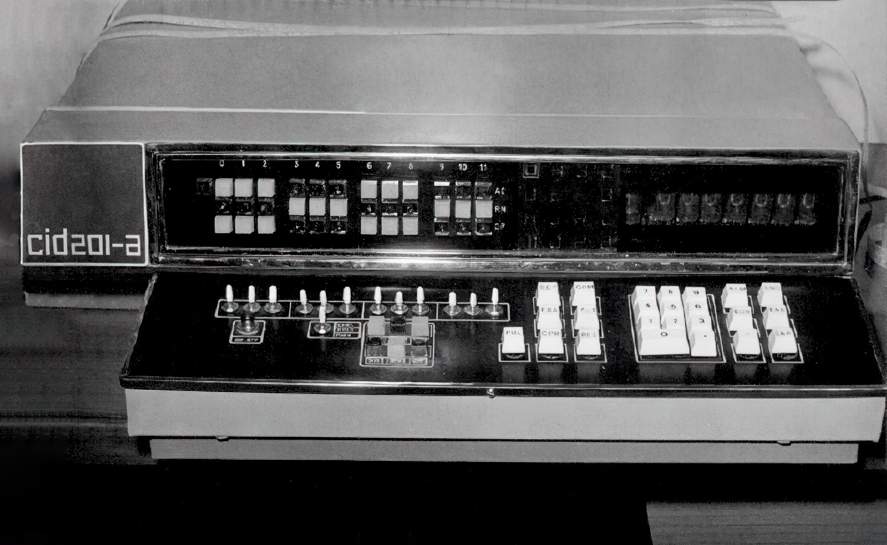
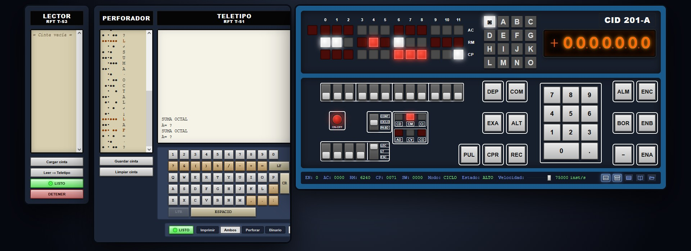
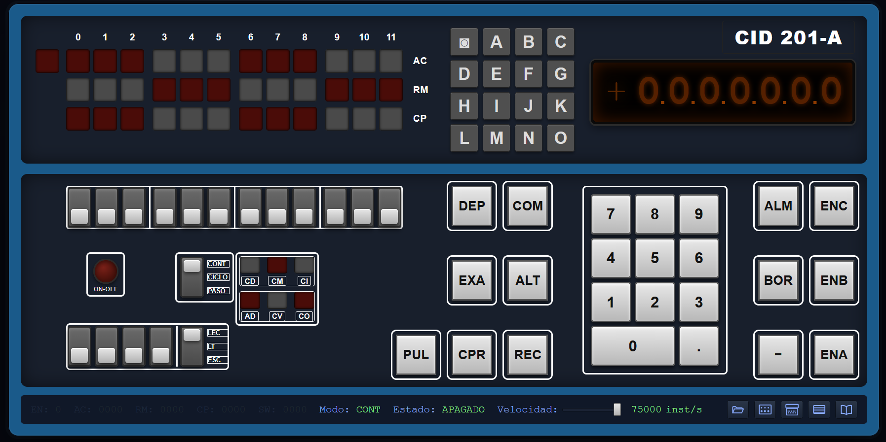
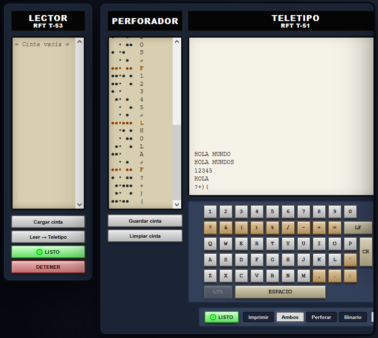

# CIDmulator-A
# CID 201-A

<p align="center"></p>

Simulador funcional, en un único archivo HTML/CSS/JS, de la minicomputadora cubana **CID 201-A** (Centro de Investigación Digital, ICID, Cuba, 1971). Reproduce el segundo modelo, su conjunto de instrucciones LEN-1, su consola física, la memoria de ferrita y sus periféricos: teletipo RFT T-51 (teleimpresora + perforador de cinta) y lector de cinta RFT T-53. Inicia con algunos programas precargados.

> Un homenaje ejecutable a una de las primeras computadoras diseñadas y fabricadas en América Latina.

<p align="center"></p>

**Atención, este es un trabajo en progreso.**

---

## Índice

1. [Inicio rápido](#inicio-rápido)
2. [Contexto histórico](#contexto-histórico)
3. [La consola](#la-consola)
4. [Arquitectura](#arquitectura)
5. [Memoria y direccionamiento](#memoria-y-direccionamiento)
6. [Conjunto de instrucciones](#conjunto-de-instrucciones)
7. [Ciclos de máquina](#ciclos-de-máquina)
8. [Periféricos](#periféricos)
9. [Monitor "Última Página"](#monitor-última-página)
10. [Programas de ejemplo](#programas-de-ejemplo)
11. [El "Minibin"](#el-minibin)
12. [Ventanas auxiliares](#ventanas-auxiliares)
13. [Estructura del proyecto](#estructura-del-proyecto)
14. [Notas técnicas](#notas-técnicas)
15. [Referencias](#referencias)
16. [Licencia](#licencia)

---

## Inicio rápido

No requiere instalación ni dependencias. Basta con abrir el archivo `CID201A.html` en un navegador moderno (Chrome, Firefox, Edge, Safari).

O ir a este vínculo: <https://maikelsz.github.io/CIDmulatorCID201A/CIDmulatorCID201A.html>

**Primeros pasos recomendados:**

1. Pulsar **ON-OFF** (botón rojo circular). El estado pasa a `ALTO`.
2. Pulsar **ENA** para cargar y ejecutar el primer programa de ejemplo (juego Simon). Se encenderán las letras A–G en secuencia.
3. Pulsar **ALT** para detener la ejecución.

<p align="center"></p>

---

## Contexto histórico

La **CID 201** fue la primera minicomputadora diseñada y fabricada en Cuba, desarrollada por el **Centro de Investigación Digital (CID)** bajo la dirección de Orlando Ramos. La **CID 201-A** (1971) fue su versión de producción en serie, con la consola integrada en el cuerpo y mejoras de interacción.

| Característica | Valor |
|---|---|
| Tipo | Minicomputadora de 3.ª generación |
| Introducción | 1971 |
| Fabricación | 1970 – 1972 |
| Unidades | ~24 |
| Longitud de palabra | 12 bits |
| Instrucciones | 59 |
| Reloj | 1 MHz |
| Velocidad | 25 000 sumas (registro + memoria) por segundo (25 Kops) |
| Memoria | Núcleos de ferrita, 4096 palabras × 12 bits |
| Ciclo de memoria | 1,5 µs |
| Tecnología | DTL, Mitsubishi M5900 (NAND, inversores, biestables JK) |
| Compatibilidad | Parcial con PDP-8 a nivel de instrucciones IRM |
| Software | LEAL, FOCAL, FORTRAN, 70/13 |
| Sistema operativo | Ninguno — ejecución directa desde memoria |

La numeración es **octal**, con el bit 0 (más a la izquierda) como el **más significativo** (big-endian). Los números se representan en **complemento a dos**:

- Sin signo: `0` … `7777` (0 … 4095)
- Con signo: `4000` … `7777` = negativos, `0000` … `3777` = positivos (−2048 … +2047)

---

## La consola

La consola de la CID 201-A reúne en un único cuerpo los indicadores, interruptores, teclas y el display numérico.

### Panel superior

- **Registros AC / RM / CP**: 12 bits cada uno, con indicadores rojo/blanco por grupo de 3 bits. El indicador **EN** (bit de enlace) está a la izquierda del AC.
- **Letras A–O**: 15 lámparas del display alfabético (solo una encendida a la vez). El símbolo `◙` es el indicador separador.
- **Display Nixie**: 7 dígitos octales + signo + puntos decimales.

### Panel inferior

| Elemento | Función |
|---|---|
| **12 interruptores** | Escriben un valor binario de 12 bits. Arriba = 1, abajo = 0 |
| **ON-OFF** | Enciende / apaga la máquina |
| **Interruptor de modo** | `CONT` (continuo) / `CICLO` / `PASO` |
| **6 LEDs de ciclo** | `CD` `CM` `CI` / `AD` `CV` `CO` |
| **4 interruptores auxiliares** | A / B / C / D (solo comportamiento visual) |
| **Mando LEC / LT / ESC** | Solo comportamiento visual (pendiente de documentar) |
| **Teclas de control** | DEP / COM / EXA / ALT / PUL / CPR |
| **Teclado decimal** | 0–7 (dígitos octales) + `.`. Programadas |
| **Teclas de control** | REC / ALM / BOR. Programadas |
| **Teclas de ejemplo** | ENA / ENB / ENC (programas precargados) |

**CPR** – El Contador de Programa recibe el valor de los interruptores como una dirección de memoria.

**DEP** – Deposita el valor de los interruptores en la dirección de memoria del CP, y lo incrementa.

**COM** – Comienza ejecución a partir de la dirección en el CP.

**ALT** – Pasa a estado de Alto.

**EXA** – Examina. Carga en RM el contenido de la dirección en CP.

**PUL** – Pulso. Puede ser un pulso único de reloj, avanzando el contador Johnson, o ejecutar un ciclo completo, dependiendo del estado del interruptor de control.

**REC / ALM / BOR** – Teclas programadas de Recepción, Almacenamiento y Borrado.

**DÍGITOS** – Entrada numérica programada.

**ENA, ENB, ENC** – Inician la ejecución a partir de la dirección indirecta contenida en `0o7775`, `0o7776` y `0o7777` respectivamente.

**CONT / CICLO / PASO** – Ejecución continua (normal), por ciclo (el botón PUL ejecuta un ciclo = 16 pulsos de reloj) o por paso (una pulsación de PUL ejecuta un solo ciclo de reloj; en el simulador, una instrucción completa con todos sus ciclos).

**LEC / L-T / TEL** – Operación con la grabadora: LECtura, NORmal (la máquina opera normal), ESCritura.

El uso de interruptores y teclas solo se puede hacer durante un estado de Alto.

Para depositar una serie de valores en memoria, primero se especifica por los interruptores la dirección de memoria y mediante la tecla CPR se pasa este valor al Contador de Programa (CP). Luego se introducen los valores a almacenar y se oprime sucesivamente la tecla DEP, que deposita el valor de los interruptores en RM y de ahí a la memoria, e incrementa el CP en uno.

Para examinar el contenido de la dirección de memoria apuntada por el CP se utiliza la tecla EXA.

Para comenzar la ejecución de un programa en una dirección dada se oprime la tecla COM, estando previamente el CP señalando a esa dirección.

La tecla ALT pone a la computadora en el estado de Alto. La ejecución del programa se reanuda desde donde se había detenido mediante la tecla COM.

Un interruptor de tres posiciones gobierna el modo de operación del reloj general, y así del programa:

- **CONTINUO**: operación sin parada alguna.
- **CICLO**: cada pulsación de PUL genera 16 pulsos de reloj = un ciclo de trabajo completo.
- **PASO**: en la computadora real, cada pulsación de PUL produce un pulso de reloj (avanza 1/18 de ciclo en el contador Johnson). En el simulador, ejecuta una instrucción completa con todos sus ciclos.

### Display numérico

El display de la consola tiene **7 dígitos**, un **signo** (+/−) y **6 puntos decimales** entre dígitos. En la máquina real son tubos Nixie de cátodo frío; en el simulador se representan como dígitos naranjas con brillo.

El display es **totalmente programable**: no está cableado a ningún registro de la CPU. Su contenido se controla desde software mediante cuatro registros internos:

| Registro | Contenido | Instrucción |
|---|---|---|
| **Registro de Números** | Valor mostrado (12 bits → 4 dígitos octales, con ceros a la izquierda) | `TAR` (0o6524): AC → Registro de Números |
| **Registro de Signo** | `+` o `−` | `TAS` (0o6500): (−) → Registro de Signo |
| **Registro de Fracción** | Puntos decimales encendidos (uno por bit) | `TAF` (0o6521): AC[0] → Registro de Fracción |
| **Registro de Títulos** | Código del display alfabético (0–15) | `TAT` (0o6522): AC[0-3] → Registro de Títulos |


### Teclado decimal

Junto al display hay un teclado con **10 teclas numéricas** (`0`–`9`), una tecla de **punto decimal** (`.`), una de **signo** (`−`) y tres teclas programables: **ALM**, **BOR**, **REC**.

**Solo los dígitos 0 a 7 son válidos**: la máquina es octal. Las teclas 8 y 9 existen físicamente pero el hardware las ignora (son teclas mudas).

Cada tecla activa un **indicador de estado** que el programa consulta mediante instrucciones de E/S:

| Tecla | Indicador | Saltar si activo | Limpiar |
|---|---|---|---|
| `0`–`7` | ID (dígito) | `SID` (0o6444) | `LID` (0o6414) |
| `ALM` | IA (almacenar) | `SIA` (0o6442) | `LIA` (0o6412) |
| `.` | IF (fracción) | `SIF` (0o6441) | `LIF` (0o6411) |
| `−` | IS (signo) | `SIS` (0o6542) | `LIS` (0o6512) |
| `BOR` | IB (borrar) | `SIB` (0o6541) | `LIB` (0o6511) |
| `REC` | IR (recuperar) | `SIR` (0o6544) | `LIR` (0o6514) |

El **valor de la tecla numérica** presionada se guarda en el **Registro de Dígitos** (3 bits, valores 0–7). Para sumarlo al acumulador:

### Indicadores alfabéticos A–O

El display alfabético de la consola tiene 15 lámparas: el símbolo **◙** (separador) y las letras **A** a **O**. Solo una puede estar encendida a la vez en la máquina real; el simulador permite encender cualquiera de ellas individualmente mediante software.

Los controla la microinstrucción `TAT` (`0o6522`), que toma el código en el acumulador:

- **0** → todas las letras apagadas
- **1** … **15** → enciende la letra correspondiente (`◙`, A, B, …, O)

El programa de ejemplo **ENA** (Simon) los usa para mostrar la secuencia de notas. Cualquier programa puede utilizarlos como display de estado o como indicadores de aplicación.

### Controles sin comportamiento funcional

Algunos controles de la consola están presentes visualmente pero no tienen efecto sobre la CPU en esta versión del simulador:

- **Interruptores auxiliares A/B/C/D** (a la izquierda del mando de modo): solo cambian su posición visual. Su función específica en la máquina real está pendiente de documentar.
- **Mando LEC/LT/ESC**: cambia de posición visualmente pero no está conectado a ningún comportamiento. Pendiente de documentar su función original.

El resto de la consola (indicadores de registros, ciclos, interruptores de 12 bits, teclado decimal, teclas de control, indicadores alfabéticos, display numérico) está completamente funcional.

### Barra de estado

Muestra en tiempo real: `EN`, `AC`, `RM`, `CP`, `SW`, modo, estado y velocidad de ejecución. Incluye un deslizador de velocidad con tres posiciones (`MIN` / `MED` / `MAX`) y botones para abrir las ventanas auxiliares.

---

## Arquitectura

### Registros

| Registro | Bits | Función |
|---|---|---|
| **AC** | 12 | Acumulador. Operaciones aritméticas y lógicas. Buffer de E/S |
| **EN** | 1 | Enlace. Acarreo de suma e incremento. Bit 12 de rotaciones |
| **RM** | 12 | Registro de memoria. Recibe la palabra leída. Gobierna inhibición al escribir |
| **CP** | 12 | Contador de programa. Próxima instrucción a ejecutar |
| **RI** | 5 | Registro de instrucción (opcode + bits de direccionamiento) |
| **RD** | 7 | Dirección relativa dentro de la página |
| **RP** | 5 | Página actual (5 bits altos de CP) |
| **RIN** | 12 | Registro de interruptores (consola) |

Casi todos los registros son de desplazamiento y operan en **serie**: los datos fluyen bit a bit, entrando por la izquierda y saliendo por la derecha.

### Unidad aritmético-lógica

- **Sumador serial de 1 bit**: realiza sumas, incrementos, complementos y detección de cero.
- **Puerta AND**: para la instrucción `YLO` (AND lógico bit a bit).
- **Rotaciones**: AC y EN forman un registro único de 13 bits que rota a izquierda o derecha.

### Ciclos

La CPU recorre **6 ciclos de máquina** (visibles en los LEDs):

| Ciclo | Significado |
|---|---|
| **CI** | *Ciclo de Instrucción*: se busca la instrucción apuntada por CP |
| **CD** | *Ciclo de Dirección*: se calcula la dirección efectiva (accesos indirectos) |
| **CO** | *Ciclo de Operación*: se ejecuta la operación |
| **CV** | *Ciclo "Ir a"* (VEA / VAS y saltos de microinstrucción) |
| **CM** | *Ciclo de Microinstrucción* (LAC, SUM, RDx, …) |
| **AD** | *Alto Dinámico*: la CPU está detenida esperando evento |

---

## Memoria y direccionamiento

- **4096 palabras** de 12 bits, organizadas en **32 páginas de 128 palabras**.
- Cada palabra de instrucción IRM tiene este formato:

```
bits:  0 1 2 | 3 | 4 | 5 6 7 8 9 10 11
       opcode | I | P |  dirección relativa (7 bits)
```

| Bit | Nombre | Significado |
|---|---|---|
| 0–2 | `opcode` | Código de operación (8 valores: 0–7) |
| 3 | `I` | 0 = directo, 1 = indirecto |
| 4 | `P` | 0 = página 0, 1 = página actual |
| 5–11 | `addr` | Dirección relativa dentro de la página |

**Direcciones efectivas:**

| Bits I P | Modo | Dirección efectiva |
|---|---|---|
| 0 0 | Directo página 0 | `[0000 … 0177]` |
| 0 1 | Directo página actual | `[CP_page · 7 bits]` |
| 1 0 | Indirecto página 0 | `[[0000 … 0177]]` |
| 1 1 | Indirecto página actual | `[[CP_page · 7 bits]]` |

Convención del ensamblador: el sufijo `I` indica **indirecto** (`SUM I ptr`).

### Saltos a subrutinas (VAS)

- La dirección de retorno se escribe en la **primera** palabra de la subrutina.
- El control pasa a la **segunda** palabra (donde comienzan las instrucciones).
- La subrutina retorna con `VEA I SUBRUT`.

---

## Conjunto de instrucciones

### Instrucciones de referencia a memoria (IRM)

Formato general: `código · indirecto · página · dirección relativa`.

| Octal | Mnemo | Operación |
|---|---|---|
| `0_` | **YLO** | `AC ← AC & [M]` (AND lógico) |
| `1_` | **SUM** | `AC ← AC + [M]` (propaga acarreo al EN) |
| `2_` | **ISC** | `[M]++`; `CP++` si `[M] == 0` |
| `3_` | **DEL** | `AC → [M]`, `0 → AC` |
| `4_` | **VAS** | `CP → [M]`, `M+1 → CP` (llamada a subrutina) |
| `5_` | **VEA** | `CP ← M` (salto) |

Los opcodes 6 y 7 se reservan para microinstrucciones y E/S.

### Grupo 0 — Limpieza (opcode 7, bit 400 = 0, bit 002 = 0)

| Octal | Mnemo | Orden | Operación |
|---|---|---|---|
| `7000` | NOP | — | Sin operación |
| `7010` | IAC | 3 | `AC + 1 → AC`; si desborda (7777 → 0000), complementa el EN |
| `7020` | CEN | 2 | `~EN → EN` |
| `7040` | CAC | 2 | `~AC → AC` |
| `7100` | LEN | 1 | `0 → EN` |
| `7200` | LAC | 1 | `0 → AC` |

**Combinaciones (mismo orden de ejecución: LAC → LEN → CAC → CEN → IAC):**

| Octal | Combinación | Resultado |
|---|---|---|
| `7050` | CAC IAC | `~AC+1 → AC` (= −AC); si hay desbordamiento, complementa EN |
| `7060` | CAC CEN | `~AC → AC`, `~EN → EN` |
| `7120` | LEN CEN | `1 → EN` |
| `7210` | LAC IAC | `1 → AC`; EN intacto (no hay desbordamiento) |
| `7220` | LAC CEN | `0 → AC`, `~EN → EN` |
| `7240` | LAC CAC | `0o7777 → AC` (LAC deja 0, CAC complementa) |
| `7300` | LAC LEN | `0 → AC`, `0 → EN` |
| `7310` | LAC LEN IAC | `1 → AC`, `0 → EN` (sin desbordamiento) |
| `7320` | LAC LEN CEN | `0 → AC`, `1 → EN` |
| `7330` | LAC LEN CEN IAC | `1 → AC`, `1 → EN` (CEN pone EN=1; IAC no desborda) |
| `7340` | LAC LEN CAC | `0o7777 → AC`, `0 → EN` |
| `7350` | LAC LEN CAC IAC | `0 → AC`, `1 → EN` (0o7777 + 1 = 0, con acarreo → complementa EN 0→1) |
| `7360` | LAC LEN CAC CEN | `0o7777 → AC`, `1 → EN` |
| `7370` | LAC LEN CAC CEN IAC | `0 → AC`, `0 → EN` (CEN pone EN=1; IAC desborda → 1 XOR 1 = 0) |

> **Nota sobre `IAC` y el `EN`:** el `IAC` opera sobre el par de 13 bits `EN/AC` (igual que el `LINK/AC` de la PDP-8). Cuando el AC pasa de `7777` a `0000`, el acarreo **complementa** el `EN` (no lo pone a 1). Esto explica los valores de las filas `7350` y `7370`: en ambas hay desbordamiento del AC, y el `EN` inicial (puesto por `LEN` y opcionalmente por `CEN`) se complementa como resultado del `IAC`.

### Grupo 1 — Rotaciones (bit 002 = 1)

Rotan el par `(EN, AC)` como un registro único de 13 bits.

| Octal | Mnemo | Operación |
|---|---|---|
| `7202` | RD1 / RI12 | Rotar 1 a la derecha (o 12 a la izquierda) |
| `7102` | RD2 / RI11 | Rotar 2 a la derecha (o 11 a la izquierda) |
| `7302` | RD3 / RI10 | Rotar 3 a la derecha (o 10 a la izquierda) |
| `7042` | RD4 / RI9 | Rotar 4 a la derecha (o 9 a la izquierda) |
| `7242` | RD5 / RI8 | Rotar 5 a la derecha (o 8 a la izquierda) |
| `7142` | RD6 / RI7 | Rotar 6 a la derecha (o 7 a la izquierda) |
| `7342` | RD7 / RI6 | Rotar 7 a la derecha (o 6 a la izquierda) |
| `7322` | RD8 / RI5 | Rotar 8 a la derecha (o 5 a la izquierda) |
| `7062` | RD9 / RI4 | Rotar 9 a la derecha (o 4 a la izquierda) |
| `7262` | RD10 / RI3 | Rotar 10 a la derecha (o 3 a la izquierda) |
| `7162` | RD11 / RI2 | Rotar 11 a la derecha (o 2 a la izquierda) |
| `7362` | RD12 / RI1 | Rotar 12 a la derecha (o 1 a la izquierda) |

### Grupo 2 — Saltos (bit 400 = 1)

Salto por *skip*: si la condición se cumple, `CP = CP + 1` (se omite la instrucción siguiente).

| Octal | Mnemo | Orden | Grupo | Condición |
|---|---|---|---|---|
| `7500` | SAN | 1 | OR | `AC < 0` |
| `7440` | SAC | 1 | OR | `AC == 0` |
| `7420` | SED | 1 | OR | `EN == 1` (EN ≠ 0) |
| `7510` | SAP | 1 | AND | `AC > 0` (SAN con SLT) |
| `7450` | SAD | 1 | AND | `AC ≠ 0` (SAC con SLT) |
| `7430` | SEC | 1 | AND | `EN == 0` (SED con SLT) |
| `7410` | SLT | 1 | — | Salto incondicional |
| `7600` | LAC | 2 | — | `0 → AC` (limpia sin saltar) |
| `7404` | ALT | 4 | — | Alto (detiene la máquina) |
| `7402` | ORI | 3 | — | `AC = AC \| Register(interruptores)` |

Los grupos `OR` y `AND` no se pueden combinar entre sí.

**Combinaciones OR (sin SLT):**

| Octal | Combinación | Condición |
|---|---|---|
| `7460` | SAC SED | `AC == 0` **o** `EN == 1` |
| `7520` | SAN SED | `AC < 0` **o** `EN == 1` |
| `7540` | SAN SAC | `AC < 0` **o** `AC == 0` (es decir, AC ≤ 0) |
| `7560` | SAN SAC SED | `AC < 0` **o** `AC == 0` **o** `EN == 1` |

**Combinaciones AND (con SLT):**

| Octal | Combinación | Condición |
|---|---|---|
| `7470` | SAD SEC | `AC ≠ 0` **y** `EN == 0` |
| `7530` | SAP SEC | `AC > 0` **y** `EN == 0` |
| `7550` | SAP SAD | `AC > 0` **y** `AC ≠ 0` (= `AC > 0`) |
| `7570` | SAP SAD SEC | `AC > 0` **y** `EN == 0` |

> `7550` y `7570` son redundantes respecto a `7510` y `7530` respectivamente (`SAD` no añade información cuando `AC > 0`). Se mantienen por fidelidad al conjunto de instrucciones original.

**Combinaciones LAC + salto:**

| Octal | Combinación | Efecto |
|---|---|---|
| `7710` | LAC SAP | Si `AC > 0`, `0 → AC` y salta |
| `7700` | LAC SAN | Si `AC < 0`, `0 → AC` y salta |
| `7650` | LAC SAD | Si `AC ≠ 0`, `0 → AC` y salta |
| `7640` | LAC SAC | Si `AC == 0`, `0 → AC` y salta |
| `7630` | LAC SEC | Si `EN == 0`, `0 → AC` y salta |
| `7620` | LAC SED | Si `EN == 1`, `0 → AC` y salta |
| `7610` | LAC SLT | `0 → AC` y salta siempre |
| `7770` | LAC SAD SEC | Si `AC > 0` y `EN == 0`, `0 → AC` y salta |

**Combinaciones con ALT** (la operación de Alto se ejecuta solo si no hubo skip):

| Octal | Combinación | Efecto |
|---|---|---|
| `7504` | SAN ALT | Si `AC < 0`, salta; si no, Alto |
| `7444` | SAC ALT | Si `AC == 0`, salta; si no, Alto |
| `7424` | SED ALT | Si `EN ≠ 0`, salta; si no, Alto |
| `7514` | SAP ALT | Si `AC > 0`, salta; si no, Alto |
| `7454` | SAD ALT | Si `AC ≠ 0`, salta; si no, Alto |
| `7434` | SEC ALT | Si `EN == 0`, salta; si no, Alto |

**Combinaciones con ORI** (el OR con interruptores se ejecuta solo si no hubo skip):

| Octal | Combinación | Efecto |
|---|---|---|
| `7502` | SAN ORI | OR con interruptores si `AC ≥ 0` |
| `7442` | SAC ORI | OR con interruptores si `AC ≠ 0` |
| `7422` | SED ORI | OR con interruptores si `EN == 0` |

> **Cómo leer las tablas de ALT y ORI:** el primer mnemónico (SAN, SAC, SAP, …) evalúa la condición y decide si salta; el segundo (ALT, ORI) **solo se ejecuta si no hubo skip**. Por eso "Alto si AC ≥ 0" equivale a "Salta si AC < 0, si no, Alto"; y "OR si AC ≥ 0" equivale a "Salta si AC < 0, si no, ORI".

### Grupo 6 — Entrada/Salida

El código de operación `110` (6) agrupa las microinstrucciones de E/S.

**Sistema de sondeo** (polling): el programa verifica periódicamente el estado del periférico. Si no está listo, se ejecutan otras operaciones.

Toda instrucción que transfiere AC a un Registro de Salida **limpia AC**. Toda instrucción que transfiere un Registro de Entrada al AC **suma** al AC (pudiendo modificar el EN con el acarreo).

#### Perforador de cinta (RFT T-51)

| Octal | Mnemo | Operación |
|---|---|---|
| `6110` | LIP | `0 → Indicador de Perforación` |
| `6120` | TAP | `AC → Registro del Perforador`, `0 → AC` |
| `6130` | TAP LIP | Combinación de las dos anteriores |
| `6140` | SIP | Salta si `Ind. Perf. == 1` |

#### Lector de cinta (RFT T-53)

| Octal | Mnemo | Operación |
|---|---|---|
| `6202` | PAL | Detiene lector |
| `6204` | COL | Inicia lector |
| `6210` | LIL | `0 → Indicador de Lectura` |
| `6220` | TLA | Registro Lector → AC |
| `6230` | TLA LIL | Transferencia + limpieza de indicador |
| `6240` | SIL | Salta si `IL == 1` |

#### Consola — teclado decimal y teclas asociadas

| Octal | Mnemo | Operación |
|---|---|---|
| `6411` | LIF | `0 → Indicador de Fracción` |
| `6412` | LIA | `0 → Indicador de ALM` |
| `6414` | LID | `0 → Indicador de Dígitos` |
| `6420` | TRA | `AC + Registro de Dígitos → AC` (propaga acarreo al EN) |
| `6441` | SIF | Salta si `IF == 1` |
| `6442` | SIA | Salta si `IA == 1` |
| `6444` | SID | Salta si `ID == 1` |

#### Consola — display numérico

| Octal | Mnemo | Operación |
|---|---|---|
| `6500` | TAS | `(−) → Registro de Signo` |
| `6511` | LIB | `0 → Indicador de BOR` |
| `6512` | LIS | `0 → Indicador de Signo` |
| `6514` | LIR | `0 → Indicador de REC` |
| `6521` | TAF | `AC(.) → Registro de Fracción` |
| `6522` | TAT | `AC(L) → Registro de Títulos` (display alfabético) |
| `6524` | TAR | `AC → Registro de Números` |
| `6541` | SIB | Salta si `IB == 1` |
| `6542` | SIS | Salta si `IS == 1` |
| `6544` | SIR | Salta si `IR == 1` |
| `6310` | LIG | Limpia **todos** los indicadores |

#### Otros dispositivos

| Octal | Mnemo | Operación | Estado en el emulador |
|---|---|---|---|
| `6611` | LIO | `0 → Indicador de Salida` | Implementado |
| `6612` | LIM | `0 → Indicador de Muestreo` | Implementado |
| `6621` | TAU | `AC → Registro Uno` | Stub (`AC + 0`) |
| `6622` | TAD | `AC → Registro Dos` | Stub (`AC + 0`) |
| `6631` | TUA | `Registro Uno → AC` | **No implementado** |
| `6632` | TDA | `Registro Dos → AC` | **No implementado** |
| `6641` | SIO | Salta si `Indicador de Salida == 1` | Implementado |
| `6642` | SIM | Salta si `Indicador de Muestreo == 1` | Implementado |

---

## Ciclos de máquina

En la máquina real un contador Johnson de 8 biestables generaba 16 turnos (`T-2` a `T+13`). Cada instrucción pasa por los ciclos del super-control:

| Ciclo | Entrada | Comportamiento |
|---|---|---|
| **CI** (Ciclo de Instrucción) | T13 → IRM | Lee instrucción desde `[CP]`, carga RD y RI |
| **CD** (Ciclo de Dirección) | CI con `I = 1` | `RD ← [RD]` (desreferencia indirecta) |
| **CO** (Ciclo de Operación) | CI / CD → IRM | Ejecuta. `CP++` o `CP += 2` según salto |
| **CV / CVM** (Ir a) | CO con VEA / micro | `CP ← RD` o `CP = RD+1 / RD+2` |
| **CM** (Ciclo de Micro) | T13 → microinstrucción | Ejecuta el microcódigo del grupo |
| **AD** (Alto Dinámico) | ALT / micro ALT | CPU detenida, esperando tecla o evento |

**Tiempos reales** (a velocidad máxima):

| Tipo | Tiempo por instrucción | Instrucciones / s |
|---|---|---|
| Microinstrucción (LAC, RDx, …) | 13,3 µs | 75 000 |
| IRM acceso directo | 40 µs | 25 000 |
| IRM acceso indirecto | 71,4 µs | 14 000 |

El deslizador de velocidad escala todo por `1/7500`, `1/750` o `1` (velocidad real).

---

## Periféricos

<p align="center"></p>

### Teletipo RFT T-51

Panel integrado con tres funciones:

1. **Teclado** ITA2 (CCITT-2): 5 bits por carácter + LTRS/FIGS + CR/LF. Sonido opcional.
2. **Impresora**: hoja de papel con cursor parpadeante. Modo `Imprimir`.
3. **Perforador de cinta**: perfora en cinta ITA2 de 5 canales. Modo `Perforar`.

Los modos de salida son: `Imprimir`, `Perforar`, `Ambos`, `Binario` (raw, sin interpretación ITA2, para cargar programas con Minibin).

**Botones:** `LISTO` (habilita recepción), `Guardar cinta`, `Limpiar cinta`, `🔊` (sonido).

### Lector de cinta RFT T-53

Panel independiente (`btn-rd` de la barra de estado).

- **Cargar cinta** (`.cinta`): lee una cinta desde disco.
- **LISTO**: habilita el lector.
- **Leer → Teletipo**: lectura manual, carácter a carácter, imprimiendo en el teletipo.
- **DETENER**: detiene el motor.

### Cintas

Formato de archivo `.cinta`: texto plano donde cada línea representa un carácter:

```
● ●•●   A      ← b0 b1 • b2 b3 b4  símbolo
```

Los símbolos `●` (o `○`) son perforaciones; `•` es la guía central. Cabeceras con `=` se ignoran al cargar.

---

## Monitor "Última Página"

Programa de control cargado en la **página 31** (`0o7600`–`0o7724`). Permite manipular la memoria con el **teclado decimal**, el **display numérico** y las teclas asociadas.

### Funcionamiento

| Operación | Cómo |
|---|---|
| **Escribir un número** | Teclear dígitos (0–7). Se acumulan en el display. Máximo 4 dígitos octales |
| **BOR (borrar)** | Elimina el último dígito (divide el valor por 8) |
| **ALM (almacenar)** | 1.ª pulsación: fija la dirección inicial. Siguientes: escriben el display en direcciones consecutivas, avanzando el puntero |
| **REC (recuperar)** | 1.ª pulsación: fija la dirección inicial. Siguientes: leen y muestran direcciones consecutivas |
| **`−` (SIGN)** | **Ejecuta** la dirección mostrada en el display (salta a ella) |

Cualquier tecla nueva durante una operación de REC cancela la operación y el número tecleado pasa a ser la nueva dirección.

Para regresar al Monitor tras ejecutar una dirección, debe hacerse ALT, CPR a 7600 y COM.

### Arranque

1. Pulsar **ENC** (carga el monitor en `0o7600` y comienza).
2. Estado `EJECUTA`. El display queda listo para recibir dígitos.

---

## Programas de ejemplo

Tres programas precargados, accesibles con las teclas de la consola:

### ENA — Simon (juego de secuencias)

Juego de memoria musical. La máquina enciende secuencias de letras (`A`–`G`) usando los indicadores alfabéticos y sus tonos correspondientes; el jugador las repite con el teclado decimal (0–7). La secuencia crece con cada acierto. Si falla: el display muestra la longitud alcanzada y la máquina se detiene (`ALT`).

**Botón:** `ENA` (carga en `0o200`).

### ENB — Suma octal

Pide dos números por el teletipo y muestra su suma en octal:

```
SUMA OCTAL
A = ? 1234
B = ? 5670
A+B = 7124
```

**Botón:** `ENB` (carga en `0o600`).

### ENC — Monitor "Última Página"

Ver sección anterior.

**Botón:** `ENC` (carga en `0o7600`).

---

## El Mínimo Binario, "Minibin"

Programa utilitario de arranque ("bootloader"), usualmente el primero cargado en la máquina, que lee una cinta perforada de 5 canales y deposita las palabras de 12 bits en memoria (las perforaciones requieren un formato).

Su código ensamblador LEN:

```
* 0                                 / Lo pondremos al inicio de la memoria
                COL LIL             / Inicia el lector. Limpia su indicador
NuevaPalabra,   LAC LEN             / Limpia AC y EN
Nuevos5bits,    RI5                 / Desplaza 5 veces (cinta de 5 canales) a la izquierda
EsperaLector,   SIL                 / Salta a la instrucción siguiente si el Lector está en 1
                VEA EsperaLector    / Si no, sigue en espera
                TLA LIL             / Transfiere desde el lector los 5 bits de la derecha del AC
                SED                 / Salta la instrucción siguiente si EN = 1 (desbordamiento)
                VEA Nuevos5bits     / No está completa la palabra
                DEL I Hacia         / Transfiere el AC a la dirección indicada por Hacia
                ISC Hacia           / Incrementa puntero Destino
                VEA NuevaPalabra
Destino,        200                 / Dirección destino de los datos, página 1
$
```

O su equivalente en octal, listo para introducir mediante los interruptores de la consola:

```
6214
7300
7322
6240
5203
6230
7420
5202
3613
2213
5201
0200
```

**Uso:**

1. Cargar una cinta `.cinta` en el lector.
2. Fijar la dirección de destino en los 12 interruptores.
3. Pulsar **CPR** (carga la dirección en CP).
4. Pulsar **DEP** para escribir el valor de los interruptores en `[CP] = Hacia`. Luego `DEP` otra vez para `[CP+1] = 0o6214` (COL LIL), etc.
5. Pulsar **COM**. El Minibin leerá la cinta y depositará el programa en memoria.

---

## Ventanas auxiliares

Accesibles desde la barra de estado:

| Icono | Ventana | Función |
|---|---|---|
| 📁 | **Cargar `.lst`** | Carga un listado LEN-1 (`DIR, CÓDIGO, …`) en memoria |
| 📄 | **Lector de cinta** | Panel del RFT T-53 |
| 🖨️ | **Teletipo** | Panel del RFT T-51 |
| 🗺️ | **Mapa de memoria** | 4096 palabras en columnas, con navegación por páginas. **Editable**: clic en una celda para editarla (octal); `Enter` guarda y salta a la siguiente; `Esc` cancela |
| 📖 | **Ayuda** | Manual de usuario completo |

---

El simulador es un **único archivo HTML autocontenido**: abrirlo en el navegador es suficiente para ejecutarlo.

---

## Notas técnicas

### Precisión de la emulación

- **Ciclos**: reproduce los 6 ciclos de máquina de la CPU (CI, CD, CO, CV, CM, AD).
- **Tiempos**: modelo de coste por instrucción con tres velocidades (micro, IRM directo, IRM indirecto), ajustable con el deslizador.
- **Registros**: 12 bits con enlace de 1 bit, incluido el efecto de rotaciones circulares de 13 bits.
- **Microinstrucciones**: combinables mediante OR de sus códigos. Orden de ejecución respetado (LAC → LEN → CAC → CEN → IAC).
- **Saltos**: modelo de *skip* (CP+1) consistente con la PDP-8.
- **Entrada/salida**: sondeo por *polling*. Todas las transferencias AC↔periférico pasan por el AC; las salidas limpian AC; las entradas suman al AC.
- **Memoria**: modelo plano de 4096 palabras con lectura/escritura no destructiva desde el punto de vista del simulador (aunque el efecto observable es equivalente).

### Acarreo y EN

El **EN** actúa como bandera de acarreo del registro conjunto `EN/AC` de 13 bits:

- **`SUM`**: `EN = 1` si `AC + M > 7777`.
- **`IAC`**: si `AC = 7777`, el incremento a `0000` **complementa** el `EN` (no lo pone a 1). Coherente con el `LINK/AC` de la PDP-8.
- **`TRA`**: propaga el acarreo de `AC + Reg. Dígitos` al `EN`.
- **Operaciones lógicas** (`YLO`) y de **transferencia** (`DEL`, `VAS`, `VEA`, `ISC`): no modifican el `EN`.
- **Limpiezas** (`LAC`, `LEN`, `CAC`, `CEN`): ponen a 0 o complementan el `EN` de forma explícita.

Si se necesita detectar desbordamiento con signo, el software debe comparar los signos de los operandos y del resultado; el hardware no lo hace por sí solo.

### Diferencias conocidas respecto a la máquina real

- El modelo de tiempos es aproximado: en hardware real los turnos del contador Johnson determinan cuándo ocurren exactamente las operaciones; aquí se respeta el **coste** por instrucción, no el desfase entre turnos.
- El display alfabético enciende como mucho una letra a la vez (como el hardware real).
- El reloj no se simula ciclo a ciclo; el modelo de coste es equivalente.
- Las instrucciones `TUA` y `TDA` no están implementadas en el emulador.

### Atajos de teclado

Cuando el teletipo está **cerrado**:

| Tecla | Acción |
|---|---|
| `0`–`9` | Dígitos octales al keypad decimal |
| `Enter` | `PUL` |
| `Esc` | `ALT` |
| `.` | `FRAC` |
| `−` | `SIGN` |
| `+` | `ALM` |
| `Del` | `BOR` |
| `Espacio` | Alterna `COM` / `ALT` |

Cuando el teletipo está **abierto**, las teclas escriben en él (modo ITA2).

### Visitantes

El proyecto integra **Vercount** (`events.vercount.one`) como contador de visitas discreto bajo la consola.

---

## Referencias

- L. Orlando Suárez, "Utilización de computadoras digitales CID en el transporte ferroviario cañero". 39 conferencia ATAC, Tomo II, octubre 1970, MINAZ
- R. Rosendi Gonzáles, "Promptuario CID 201-A", MINAZ, Cuba, 1971
- O. Ramos, "La computadora CID 201-A", Comunicaciones. Revista Técnica, Núm. 13, Cuba, 1972
- O. Carnota. "Aplicación de las computadoras en un país en vías de desarrollo. Cuba", Economía y Desarrollo No 9, 1972
- L. O. Suárez, "Trabajo en el central 'Camilo Cienfuegos': itinerarios del ferrocarril cañero y análisis del proceso industrial", Primera Reunión de Especialistas de Computación de Cuba, 22-24 de marzo, 1972
- J. Pedre, "Sistema de Control de Zafra del Puesto de Mando del Yarey, Oriente, diseñado para la computadora cubana CID-201", Primera Reunión de Especialistas de Computación de Cuba, 22-24 de marzo, 1972, Cuba.
- J. Pedre, "Experiencias en la realización de trabajos prácticos en una pequeña computadora. Sistema control diario de Zafra Yarey-Oriente", Control Cibernética y Automatización, Vol. 7 Núm 1, 1973, Cuba
- H. Lista Roiz, "El uso de grabadoras portátiles tipo casete como equipo de entrada y salida en las computadoras CID-201A", Comunicaciones. Revista Técnica, Núm. 13, 1972
- P. Albuerne, "La Computadora en el Análisis de los Costes Azucareros", ATAC Núm. 5/6, 1973, MINAZ, Cuba
- V. Trejo et al, "Lenguaje para la simulación digital de sistemas dinámicos continuos", Control Cibernética y Automatización, Vol. 7 Núm. 1, 1973
- A. Ball-Llovera, "Sincronismo en las computadoras serie", Control Cibernética y Automatización, Vol. 8 Núm.3, 1974
- L. García Fernández, "Simulación de la operación de un puerto en la CID-201-A", Control Cibernética y Automatización, Vol. 8 Núm. 1, 1974
- J. J. Hernández Ruiz, "Tablas de decisión y su implementación en el equipo CID-201A", Control Cibernética y Automatización, Vol. 8 Núm. 3, 1975
- O. Ramos, N. Blanco, "Diseño de Computadoras Digitales", Editorial Científico Técnica, 1988, La Habana
- A. Ball-Llovera, "Arquitectura de la CID 201", Bioingeniería y Física Médica Cubana. Vol. 11, Núm. 1, enero-abril, pp. 13-18, 2010
- The Software Writing Group Programming Department, "Introduction to programming PDP-8 family computers", Small Computer Handbook Series, Programming Department, Digital Equipment Corporation, 1969
- "PDP-8/S Maintenance Manual", Digital Equipment Corporation, 1967
- "¡Diez millones de operaciones por segundo!", Granma, 27 de septiembre, 1970
- "En cuanto a computadoras". Bohemia, 11 de febrero, 1972
- "¿Puede una computadora dirigir un equipo de béisbol?". Granma, 25 de agosto, 1972
- "La informática aplicada al transporte". Bohemia, 2 de marzo, 1973
- "La máquina electrónica en función del deporte". Granma, 12 de septiembre, 1974
- "A siete años de la primera computadora digital cubana". Bohemia, 3 de junio, 1977
- J. M. Barruecos, "Fidel, la Universidad, la Ciencia y la Tecnología: origen y desarrollo de la Computación en Cuba". Revista Cuba Socialista, 4ta. Época, No. 2, mayo-agosto 2016, p. 21-25
- "Entrevista realizada al ingeniero Orlando Ramos, diseñador de la primera minicomputadora cubana con motivo del décimo aniversario de este importante logro", CID: Electrónica y proceso de datos en Cuba, Núm. 1, 1981, INSAC, Cuba
- Intervención del Dr. Antonio Ball-Llovera Díaz en el Acto efectuado en el Anfiteatro de la CUJAE en ocasión del 40 Aniversario de la Primera Computadora Digital Cubana. Abril de 2010
- J. Andrés Chacón, "Proyecto C", Arte y Literatura, 1978, La Habana
- Información extraída de un documento elaborado por el Ing. Ricardo Piñero, uno de los creadores de la primera computadora, marzo 2019.

### Agradecimientos

A los ingenieros del **Centro de Investigación Digital (CID)** de Cuba, que diseñaron y construyeron la CID 201 / 201-A entre 1970 y 1972, y a las personas que han preservado su documentación y memoria.

